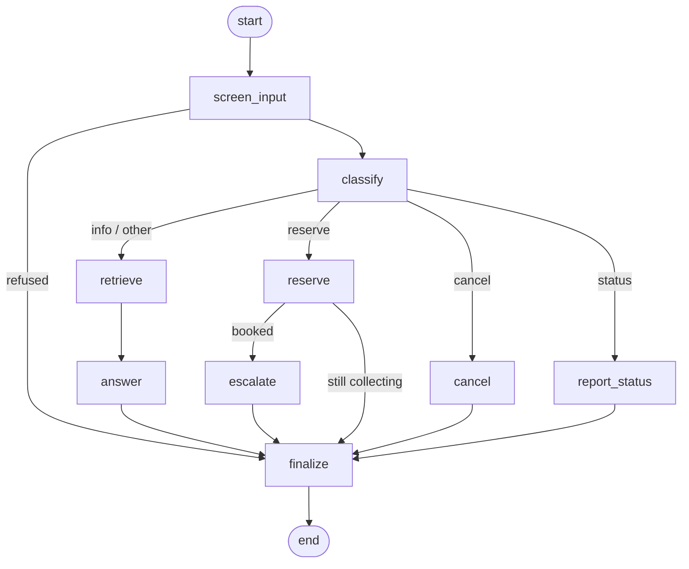
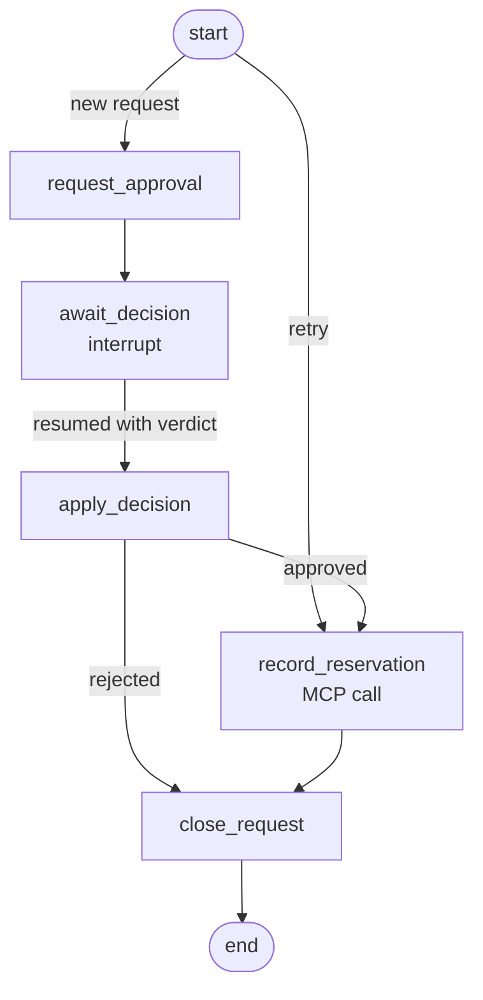

# Parking Assistant


RAG chatbot for the fictional SkyPark Central parking garage. It answers questions about the garage, collects the details for a reservation, protects confidential data and ships with an evaluation of retrieval quality, latency and data protection. A second agent asks a human administrator, over Telegram, to approve each reservation (human-in-the-loop). Approved reservations are written to a text file through an MCP server. The three parts are orchestrated end to end with LangGraph.

Documentation: [architecture](docs/architecture.md) (graphs, agent and server logic, failure behaviour, load-test results) and [setup and deployment](docs/deployment.md) (local, three processes, Docker Compose).

## How it works

Two LangGraph graphs, linked by the `escalate` node (print them with `parking-assistant graph`).

**Conversation graph** ([assistant.py](src/parking_assistant/assistant.py)), one per chat session; history and reservation draft live in the graph state.



**Reservation workflow graph** ([workflow.py](src/parking_assistant/workflow.py)), one durable run per reservation, checkpointed in SQLite. It pauses at `interrupt` until the administrator decides, and the administrator agent can resume it from another process.



- **Static data** (general information, parking details, location, booking process, FAQ) lives in `data/static/` and is stored as embeddings in Milvus (Milvus Lite, a local file). The sub-directory `public/` or `internal/` becomes the `visibility` metadata of each chunk; every search is filtered to `visibility == "public"`, so internal documents are never retrieved.
- **Dynamic data** (opening hours, prices, free spaces, reservations) lives in SQLite (`data/dynamic/`) and is injected into the prompt when the question needs it.
- **Reservation** collects first name, last name, car number and period step by step. Values are validated (letters-only names, plate format, no past or over-long periods), summarised, and stored only after the user confirms.
- **Human-in-the-loop** ([administrator.py](src/parking_assistant/administrator.py), [workflow.py](src/parking_assistant/workflow.py)): after the customer confirms the summary the reservation is stored as `pending` and the `escalate` node starts a workflow run. Its first step hands the request to the administrator agent, which writes a short LLM note on the request and sends the details to the administrator on Telegram. The administrator taps **Approve** or **Reject** under the request; Reject makes the bot ask for the reason (send `-` for none, `/cancel` to keep the request pending). Replying in free text ("ok", "no, closed that day") also works: the agent interprets the reply with the LLM (approve / reject / unclear, asking again when unclear), resumes the paused workflow run with the verdict (the run updates the reservation in SQLite) and acknowledges. The customer is told the decision in the chat as soon as it is recorded (a background check every few seconds), and can ask for the status at any time. Rejected requests release their space.
- **Confirmed reservations via MCP** ([mcp_server.py](src/parking_assistant/mcp_server.py), [archive.py](src/parking_assistant/archive.py)): when the administrator approves, the workflow's `record_reservation` step calls the `record_confirmed_reservation` tool of an MCP server, which appends `Name | Car Number | Reservation Period | Approval Time` to `var/confirmed_reservations.txt`, for example `Anna Kowalska | ABC123 | 2026-10-25 09:00 - 2026-10-25 17:30 | 2026-10-24 22:15`. The server is a small Python MCP server (official MCP SDK, Streamable HTTP over Starlette/uvicorn).
  - **Security:** every request needs `Authorization: Bearer <PARKING_MCP_TOKEN>` (constant-time comparison; the server refuses to start with a token shorter than 24 characters); a client that sends 10 wrong tokens within a minute is blocked with HTTP 429; the server listens on `127.0.0.1` only, checks the `Host` header against DNS-rebinding, and limits request bodies to 8 KB; only `/health` is public. The tool takes structured fields, not a raw line, and validates them (letters-only names, plate and timestamp formats, departure after arrival), so no value can add a column or a line to the file. Rejected values are never echoed back. The file is created with mode `0600`.
  - **Reliability:** appends are locked (`flock`) and fsynced, so concurrent writers cannot corrupt the file; identical entries are written once, which makes retries safe. If the server is down, the reservation stays confirmed but queued in SQLite (`archived = 0`) and the workflow is re-entered at `record_reservation` before every administrator poll until it is stored; the administrator is told when this happens.
  - Use HTTPS (a reverse proxy) if you ever expose the server beyond localhost.
- **Guard rails** ([guardrails.py](src/parking_assistant/guardrails.py)):
  - input: regex policies refuse prompt injection and requests for staff contacts, access codes, other customers' data and internal documents;
  - input and output: Presidio (spaCy NER and pattern recognizers) masks card numbers, IBANs, SSNs, e-mails, phone numbers, IPs and credentials; the garage's public contacts are allow-listed.

## Setup

Requires Python 3.11-3.13.

```bash
python -m venv .venv
source .venv/bin/activate
pip install -e ".[dev]"
cp .env.example .env   # set OPENAI_API_KEY (or the Azure OpenAI variables)
```

Embeddings run locally with FastEmbed, so only the chat model needs an API key.

### Administrator bot (Telegram)

1. In Telegram, talk to `@BotFather`, run `/newbot` and copy the token.
2. Put the token in `.env` as `PARKING_TELEGRAM_BOT_TOKEN` (never commit it).
3. Run `parking-assistant admin` and send any message to your bot. Without a chat id the command only runs in setup mode: it prints your chat id and exits. Put that id in `.env` as `PARKING_TELEGRAM_ADMIN_CHAT_ID`, then run `parking-assistant admin` again to start listening.

Only the configured chat can decide; messages from other chats are ignored. Without Telegram settings the chat still works, but reservations stay `pending`.

### Docker

```bash
docker compose up -d --build   # MCP server + administrator agent (reads .env)
docker compose run --rm chat   # interactive chat
```

See [docs/deployment.md](docs/deployment.md) for volumes, ports and operating notes.

### MCP server token

Generate a long random secret and put it in `.env` as `PARKING_MCP_TOKEN`:

```bash
python -c "import secrets; print(secrets.token_urlsafe(32))"
```

The server and the administrator agent read the same value. Without it, approvals still work but are not written to the file (they wait in the retry queue).

## Usage

```bash
parking-assistant ingest                  # (re)build the vector store (also runs automatically when missing)
parking-assistant run                     # everything in one process: MCP server + administrator agent + chat
parking-assistant chat                    # talk to the assistant
parking-assistant admin                   # run the administrator agent (keep it running in a second terminal)
parking-assistant mcp-server              # run the MCP server that stores confirmed reservations (third terminal)
parking-assistant graph                   # print both LangGraph diagrams as Mermaid
parking-assistant loadtest                # load test chat, administrator and MCP -> reports/load_test_report.md
parking-assistant evaluate                # retrieval accuracy, latency, data protection -> reports/evaluation_report.md
parking-assistant evaluate --end-to-end   # additionally time full LLM answers
pytest                                    # unit and integration tests (no API key needed)
```

Settings can be overridden with `PARKING_*` environment variables, see [config.py](src/parking_assistant/config.py).

Typical demo: `parking-assistant run`, or start `parking-assistant mcp-server`, `parking-assistant admin` and `parking-assistant chat` in three terminals, book a space in the chat, answer the request in Telegram, and read the new line in `var/confirmed_reservations.txt`.

## Evaluation

`parking-assistant evaluate` uses the datasets in `data/eval/`:

- `retrieval.json`: questions with the chunk ids that should be retrieved. Reports Recall@K, Precision@K, hit rate@K and MRR for K = 1, 3, 5, plus retrieval latency (mean, p50, p95, max). Duplicate chunk ids are counted once.
- `guardrails.json`: attacks that must be refused, legitimate messages that must pass, personal data that must be masked, and probes that must not retrieve confidential text.

The generated report is written to `reports/evaluation_report.md`.

## Testing and load testing

- `pytest` runs unit tests for every module (at least two each) and integration tests ([tests/test_pipeline.py](tests/test_pipeline.py)) that drive chat, workflow, administrator and a real MCP server together, including parallel approvals and resuming a run from a second database connection.
- `parking-assistant loadtest` runs the chatbot in interactive dialogue mode, administrator confirmations and MCP recording under concurrency, checks the stored file against the expected count, and writes [reports/load_test_report.md](reports/load_test_report.md). Default run: 24 sessions with 0 errors, 24 decisions with exactly 20 confirmed lines stored, 300 MCP writes without a duplicate. The MCP server sustains roughly 20 to 40 calls per second (protocol overhead per call, not storage); see [docs/architecture.md](docs/architecture.md).

## Structure

```
data/static/{public,internal}/   source documents for the vector store
data/dynamic/                    SQLite schema and seed data
data/eval/                       evaluation datasets
docs/                            architecture and deployment documentation
reports/                         evaluation and load-test reports
Dockerfile, docker-compose.yml   container deployment
src/parking_assistant/
    assistant.py                 conversation graph and chat entry point (first agent)
    workflow.py                  reservation workflow graph: approval, interrupt/resume, MCP recording
    administrator.py             administrator agent: request desk, reply interpretation, polling loop
    loadtest.py                  load test harness and report
    approval.py                  decision model, request targeting, administrator/customer messages
    telegram.py                  Telegram Bot API channel
    mcp_server.py                MCP server: bearer-token auth, throttling, the record_confirmed_reservation tool
    confirmed_log.py             validated entry model and the locked, append-only reservations file
    archive.py                   MCP client used by the administrator agent, with retries
    conversation.py              LLM prompts: routing, slot extraction, answering
    reservation.py               pure reservation logic and messages
    knowledge.py                 chunking, Milvus ingestion and public-only search
    database.py, live_data.py    SQLite access (reservations and approval status), live data formatting
    guardrails.py                input filtering and PII masking
    evaluation.py                metrics, runners, report
    composition.py, __main__.py  wiring and CLI
tests/                           pytest suite
```
