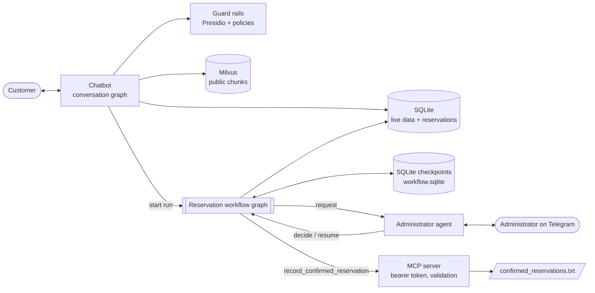
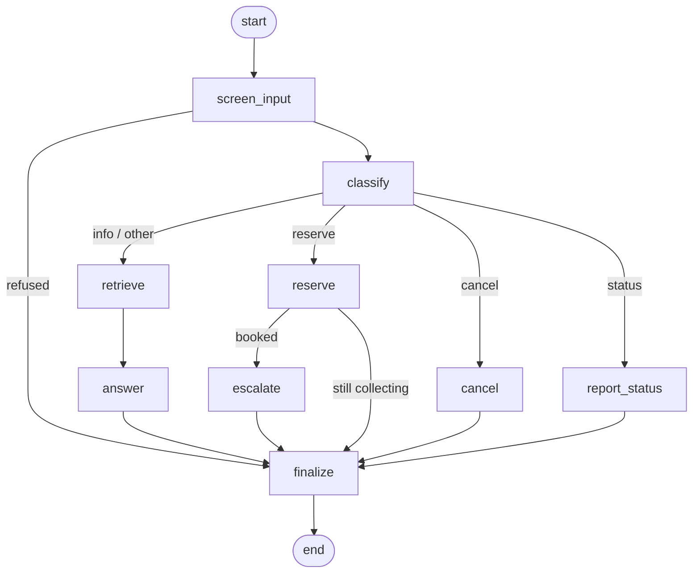
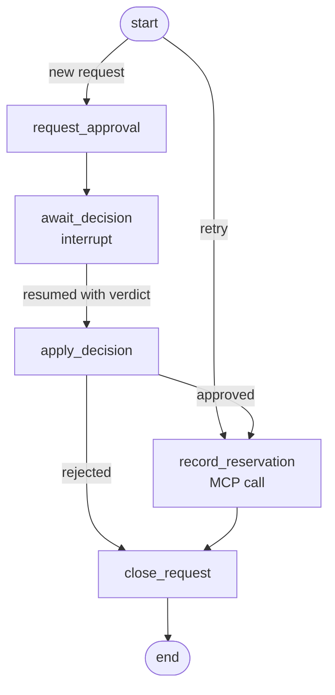
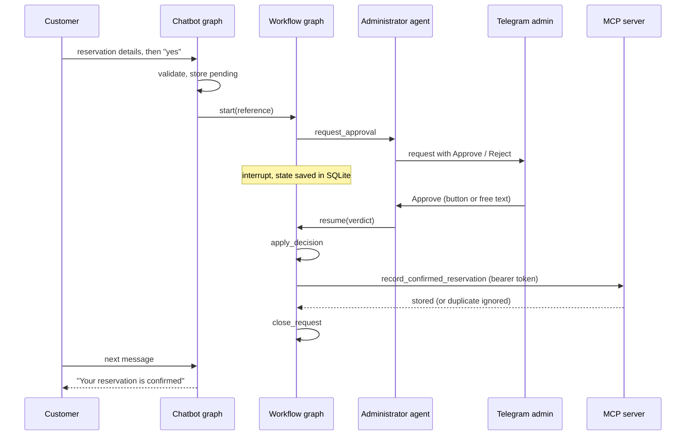

# Architecture

The system is a parking assistant for the fictional SkyPark Central garage. Three cooperating parts are orchestrated with LangGraph:

| Part | Responsibility | Code |
|---|---|---|
| Chatbot (RAG agent) | Talks to the customer, answers from the knowledge base and live data, collects the reservation, hands it over | [assistant.py](../src/parking_assistant/assistant.py) |
| Administrator agent | Asks the human administrator (Telegram) to approve or reject, interprets the reply | [administrator.py](../src/parking_assistant/administrator.py) |
| MCP server | Stores confirmed reservations in a text file | [mcp_server.py](../src/parking_assistant/mcp_server.py) |

The order of the steps is not coded as calls between these parts. It is two LangGraph graphs; the parts are the nodes' collaborators.

## Components

## Graph 1: conversation (one per chat session)

State (history, reservation draft, session id) is held per session in an in-memory checkpointer.

- `screen_input` refuses prompt injection and requests for internal data, and masks personal data.
- `classify` asks the LLM for the intent: information, reserve, cancel, status or other.
- `retrieve` searches Milvus (filter `visibility == "public"`) and adds live data (hours, prices, free spaces) from SQLite when relevant; `answer` writes the reply from that context only.
- `reserve` extracts first name, last name, car number and period with the LLM, validates them in code, asks for what is missing, summarises, and stores the booking as `pending` only after the customer confirms.
- `escalate` starts the workflow run for the new reservation. It is the only link between the two graphs.
- `finalize` prepends new administrator decisions and masks personal data in the reply.

## Graph 2: reservation workflow (one durable run per reservation)

Each run has the thread id `reservation-<ref>` and is checkpointed in `var/workflow.sqlite`.

- `request_approval` sends the request (LLM note, inline Approve/Reject buttons) to the administrator.
- `await_decision` calls LangGraph `interrupt`. The run is suspended and persisted; no process has to stay alive. This is the human-in-the-loop point.
- The administrator agent resumes the run with `Command(resume=verdict)`. Because the checkpointer is a SQLite file, the agent can run in a different process (or container) from the chatbot.
- `apply_decision` writes the verdict to the reservation row: `confirmed` or `rejected`, decision time, optional reason. A rejected reservation releases its space.
- `record_reservation` calls the MCP tool. If the server is unreachable the reservation stays `confirmed` with `archived = 0`; the entry point `phase == "retry"` re-enters the graph at this node. `retry_pending()` runs before every administrator poll until the line is stored.
- `close_request` stores the final status in the run state and ends the run. The customer learns the outcome from the reservation row: the chatbot prepends new decisions to the next reply (and a background check in `chat` shows them as they arrive).

Decisions are idempotent: a second decision for the same reservation (button pressed twice, two administrators) is reported as "already decided" and changes nothing.

Both diagrams can be printed from the code with `parking-assistant graph`.

## Sequence of a booking

## Agent logic

**Chatbot.** Every turn passes the guard rails first. Intent routing, slot extraction and answering are separate LLM calls with narrow prompts; validation, dates and status changes are plain code, so the model cannot invent a booking. The chatbot never sees internal documents: they are indexed with `visibility = internal` and filtered out of every search.

**Administrator agent.** Two halves with separate responsibilities:

- `AdminDesk` (outgoing): writes the request note, sends it with buttons, re-sends requests that could not be delivered.
- `AdministratorAgent` (incoming): receives button presses and messages, only from the configured chat id. Buttons give a clear verdict; Reject then asks for the reason (`-` for none, `/cancel` keeps the request pending). Free text is interpreted by the LLM as approve / reject / unclear and the agent asks again when unclear. Every decision goes through `ReservationWorkflow.decide`, never straight to the database.

**MCP server.** One tool, `record_confirmed_reservation(name, car_number, period_start, period_end, approved_at)`:

- Bearer-token authentication (constant-time comparison; refuses to start with a token shorter than 24 characters); 10 wrong tokens in a minute block the client with HTTP 429.
- Fields are validated separately (letters-only names, plate and timestamp formats, departure after arrival), so no value can add a column or line. Rejected values are not echoed back.
- Appends are locked (`flock`) and fsynced; identical entries are stored once, which makes retries safe. The file mode is `0600`.
- DNS-rebinding protection through an allowed `Host` list, 8 KB request limit, only `/health` is public.

Line format: `Name | Car Number | Reservation Period | Approval Time`.

## Persistence

| Store | Content | Shared between processes |
|---|---|---|
| `var/milvus.db` (Milvus Lite) | Embeddings of public documents | No: single process (chat) |
| `var/parking.sqlite` | Live data, reservations and their status | Yes (SQLite, one connection per thread) |
| `var/workflow.sqlite` | Workflow checkpoints (WAL, 30 s busy timeout) | Yes |
| `var/confirmed_reservations.txt` | Confirmed reservations, owned by the MCP server | Through MCP only |

## Failure behaviour

| Failure | Result |
|---|---|
| MCP server down | Reservation stays confirmed and queued; retried before each poll; administrator informed |
| Telegram unreachable | Request marked not delivered, re-sent later; the chat tells the customer it is saved |
| Administrator process restarted | Pending runs are intact in the checkpoint database and resume on the next decision |
| LLM error in a chat turn | The customer gets an apology and the session continues; only the exception type is logged |
| Same decision twice | Ignored, reported as already decided |
| Same reservation recorded twice | Single line in the file |

## Security summary

- Secrets only in `.env` or the environment, never in the image or the logs.
- Guard rails on input and output; internal documents never reach the model.
- The administrator decides only from the configured Telegram chat.
- The MCP server is authenticated, rate-limited against token guessing, input-validated and bound to localhost by default. Put HTTPS in front of it if it is ever exposed.
- The container runs as a non-root user.

## Testing

| Level | Where |
|---|---|
| Unit, at least two tests per module | `tests/test_<module>.py` |
| Workflow, including resume from a second connection (cross-process) | `tests/test_workflow.py` |
| Integration of all steps with a real MCP server thread and SQLite checkpoint files, including 12 parallel approvals | `tests/test_pipeline.py` |
| Load test (chat, administrator, MCP) | `parking-assistant loadtest`, report in `reports/load_test_report.md` |
| Retrieval and guard-rail evaluation | `parking-assistant evaluate`, report in `reports/evaluation_report.md` |

### Load test results (default parameters)

24 chat sessions at concurrency 8 with a rule-based stub in place of the chat model, a stand-in for Telegram, and the real graphs, SQLite, Milvus, guard rails and MCP server:

- Chat: 24 sessions, 0 errors; information question about 113 ms, reservation step about 86 ms, confirmation about 123 ms (without model latency).
- Administrator: 24 decisions, 0 errors; 20 confirmed and exactly 20 lines in the file; about 272 ms per decision including the MCP write.
- MCP: 300 calls for 300 distinct reservations, 300 lines, 0 errors, 0 duplicates after replaying 20 requests.
- The MCP server sustains about 20 to 40 calls per second whatever the client count: one client takes about 26 ms per call, 16 parallel clients about 800 ms each. Writing the file takes 0.12 ms, so the limit is the per-request overhead of the MCP protocol (a stateless session is created per call), not the storage. The expected load (one approval per administrator decision) is far below it.
- With the real model, a full booking in natural language works; an information answer takes about 2.6 s and a booking step about 1.8 s.

## Design decisions

- **Two graphs instead of one.** A conversation lives for minutes and is held in memory; an approval can take hours and must survive restarts. Separate graphs let each have the right persistence, and the second can be resumed from another process.
- **`interrupt` instead of polling in the graph.** The run costs nothing while waiting and is resumed exactly once.
- **Retry through the graph entry point.** Re-running only `record_reservation` keeps the recording logic in one place.
- **MCP at the end only.** The file is written only after a human decision, and only through the authenticated tool.
- **Limits.** Milvus Lite allows one process, so only the chat process uses the vector store. SQLite fits a single garage; a larger deployment would move SQLite to PostgreSQL and the checkpointer to its Postgres saver without changing the graphs.
